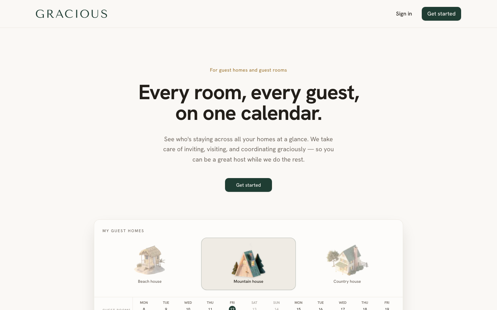

# Gracious



A hosting calendar that lets friends and family book a room in your home like a hotel.

**Live:** [gracious.host](https://gracious.host)  
**Stack:** Next.js 16 (App Router), TypeScript, Tailwind, shadcn/ui, Supabase, Stripe, Resend + React Email

---

## Setup

### 1. Supabase

1. Create a project at [supabase.com](https://supabase.com)
2. Run migrations in the SQL editor (in order):
   - `supabase/migrations/001_initial_schema.sql`
   - `supabase/migrations/002_fix_auth_user_trigger.sql` (required if signup shows **"Database error saving new user"**)
3. Enable Email auth (magic link + email/password) in Authentication → Providers
4. Add your site URL to Authentication → URL Configuration:
   - Site URL: `http://localhost:3000` (or production URL)
   - Redirect URLs: `http://localhost:3000/auth/callback`

### 2. Environment

Copy `.env.example` to `.env.local`:

```bash
cp .env.example .env.local
```

Fill in:

- `NEXT_PUBLIC_SUPABASE_URL`
- `NEXT_PUBLIC_SUPABASE_ANON_KEY`
- `SUPABASE_SERVICE_ROLE_KEY`
- `RESEND_API_KEY` (optional in dev — emails log to console)
- `RESEND_FROM`
- `NEXT_PUBLIC_APP_URL`
- `CRON_SECRET`

### 3. Run

```bash
npm install
npm run dev
```

Open [http://localhost:3000](http://localhost:3000).

## User flows

### Owner
1. Sign up at `/signup`
2. Create a property on `/dashboard`
3. Add rooms, edit house profile
4. Send invitations from Guests
5. Approve/decline requests from Requests

### Guest
1. Open invitation link `/invite/[token]`
2. Sign in via magic link
3. Request or accept a stay
4. Manage visits at `/my-visits`

## Cron (Vercel)

Daily at 9am UTC: trip reminders (7d, 1d) and invitation-expiring notices.

Set `CRON_SECRET` and configure `vercel.json` crons on deploy.

## Deploy

Deploy to Vercel with all env vars. Run the Supabase migration on your production project.
